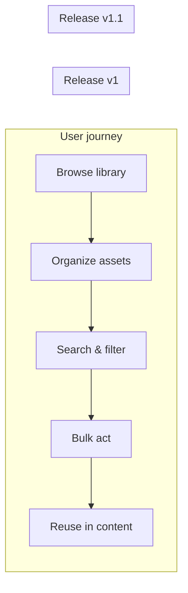

# Major feature roadmap

Plan a **major feature** (multi-epic, multi-release) as markdown extras: initiative spec, story map, optional Jira publish. Orchestrator owns initiative **phases** and architecture sessions. Does not implement stories.

**Prose:** apply `anti-slop` to the initiative spec, story map, and Jira descriptions — expand abbreviations on first use; concrete scope, no roadmap buzzwords.

## Boundaries

| Use this skill | Use something else |
|----------------|-------------------|
| Multi-epic initiative, release train, capability map | One epic or story → the story Plan step / `to-prd` |
| Story map + constraints + phased slices | Stress-test one decision → `grill-with-docs` |
| Relentless pre-plan interview (no draft first) | `grill-me` |
| Publish capability epics + v1 stories to Jira | Thin vertical slices from a plan → `to-issues` |

**Non-goals:** no code, no RED tests, no full story backlog for future slices, no architecture decision records (ADRs) unless listing ADR candidates.

## Interaction model

**Not like `grill-me` upfront.** `grill-me` interviews relentlessly *before* structure exists — one question at a time until every branch is resolved. This skill **synthesizes a draft first** (like `to-prd`), then uses **targeted Q&A** only where the draft is weak or the user pushes back.

| Phase | Mode |
|-------|------|
| 1. Explore + draft | Synthesize from conversation + repo — **no** 50-question interview |
| 2. Approval | Present capability map, story map, v1 slice; ask **focused** questions (scope, slices, priorities) |
| 3. Gaps | If a capability has fuzzy constraints → **one question at a time** with a recommended answer (grill-me *style*, but scoped to that gap) |
| 4. Deep dive (optional) | User says "grill capability X" → `grill-with-docs` or `grill-me` |

**Not `ponytail`.** `ponytail` governs **implementation** laziness (YAGNI, shortest diff). It does not belong in roadmap planning — scope here should be **right-sized for the initiative**, not minimized to one line.

**`caveman` planning carve-out.** While running this skill, use **normal clarity** (full sentences, scannable tables, complete spec prose) for chat and all artifacts — initiative spec, Jira descriptions, story map. Resume caveman only after roadmap work is done.

## Repo configuration

Read the repo's docs before planning:

1. **`docs/agents/issue-tracker.md`** — Jira project key, issue types (`Epic`, `Story`, …), epic link field conventions, labels. Set it up by hand if missing.
2. **`docs/agents/domain.md`** — `CONTEXT.md` layout, architecture decision record (ADR) paths, **initiative spec directory** (if documented).
3. **`CONTEXT.md`** / **`docs/adr/`** — domain language and decisions in scope.

**Initiative spec path** (pick first match):

1. Path from `docs/agents/domain.md` or `docs/agents/initiative-specs.md`
2. Existing convention in repo (e.g. `.harness/initiatives/<slug>/initiative.md`)
3. Default: **`.harness/initiatives/<slug>/initiative.md`**. The Orchestrator Paseo plugin owns this layout (`initiative.md` + `epics/E<n>-<name>/`). Create the folder with its **New initiative** button rather than by hand, then write the spec into the `initiative.md` it made.

Plan Markdown for the same train (architecture, UX, security) lives **beside** that file, not in a separate folder.

Use the project's **domain glossary** throughout. Respect ADRs in the affected area.

## Hierarchy → Jira mapping

| Planning level | Jira | Spec location |
|----------------|------|---------------|
| Initiative | Optional parent Epic (or roadmap doc only) | Initiative markdown file |
| Capability | **Epic** — full capability spec in **description** | Initiative file section + epic description (mirror) |
| Feature | Named in initiative; may map 1 epic or 1–3 stories later | Initiative file feature list |
| Story (v1 slice only) | **Story** — implementation spec in **description** | Initiative file v1 section + story description (mirror) |

Future release slices stay at **feature granularity** in the initiative doc until scheduled — do not create Jira stories for them in pass 1.

## Spec levels (epic vs story)

| Level | What goes in the spec | Jira | Granularity |
|-------|----------------------|------|-------------|
| **Capability / Epic** | **Overview** — UX scope, tech constraints, integrations, full feature list, dependencies, capability-level acceptance, **open ambiguities** | Epic `description` | "What this area covers and how it fits the initiative" |
| **v1 Story** | **Implementation** — user story, AC, data/API, UI surfaces, verification, story-specific out of scope | Story `description` | "Exactly what to build for this shippable slice" |

Epic descriptions are the **capability overview** (self-contained). Story descriptions are the **delivery spec** for one increment — grounded in the repo, not a repeat of the whole epic.

Do not put story-level implementation detail only in the epic. Do not put epic-wide feature lists only in stories.

## Ambiguity register (required)

Surface unknowns explicitly so the roadmap stays honest and feature planning stays on-point.

**During synthesis**, flag ambiguities you cannot resolve from chat + repo:

| Field | Meaning |
|-------|---------|
| **Question** | What is unclear |
| **Impact** | Which capability, feature, or slice it affects |
| **Assumption (draft)** | Your recommended default if the user does not care |
| **Blocks** | `v1` \| `v1.1+` \| `initiative` — what cannot be finalized until resolved |
| **Status** | `open` \| `resolved` \| `deferred` |

**During approval (step 2)**, present the **ambiguity register** with the capability map. Resolve `open` items that **block v1** via targeted Q&A (one question at a time + recommended answer). User may **defer** non-blocking items to a later slice.

**Before Jira publish — strict v1 gate:**

1. **Epics first** — create all capability epics (and optional parent initiative epic).
2. **Zero open v1 ambiguities** — across the **entire initiative**, every ambiguity with `Blocks: v1` must be `resolved` or reclassified to `deferred` with `Blocks: v1.1+` (and the affected feature moved off v1). **No v1 story may be created until this is true for all v1 capabilities.**
3. **Epic descriptions** — may list `Open ambiguities` only for `v1.1+` or `initiative` (deferred/honest overview).
4. **v1 stories** — each includes **resolved assumptions** that locked the implementation spec.

Optional: unresolved `initiative`-level ambiguities → architecture decision record (ADR) candidates or `grill-with-docs` handoff (does not block v1 stories if they do not touch v1 scope).

## Getting started (first prompt)

User invokes the skill and describes the major feature. Minimum useful input:

- **What** — feature area in one or two sentences
- **Who** — primary users (optional but helps capabilities)
- **v1 must-haves** — if known (optional; agent will propose)

Agent synthesizes from prompt + repo. Richer first prompts reduce approval rounds; thin prompts still work.

## Cross-cutting capabilities

Flag performance, permissions, security, compatibility, and migration explicitly — as dedicated capabilities or labeled on affected features. See [references.md](references.md).

## Process

Copy this checklist and track progress:

```
- [ ] 1. Explore repo + synthesize draft (+ ambiguity register)
- [ ] 2. Present map + story map + ambiguities + v1 slice → targeted Q&A → user approves
- [ ] 3. Write initiative spec markdown
- [ ] 4. Create Jira epics (MCP) with capability overview specs
- [ ] 4b. Verify zero open `Blocks: v1` ambiguities (strict gate)
- [ ] 5. Create v1 stories (MCP) with story implementation specs
- [ ] 6. Link dependencies + print summary
```

### 1. Explore and synthesize (no interview first)

From conversation + repo exploration, draft:

- **Initiative** — name, one-liner outcome, roadmap themes, success metrics
- **Current state** — what exists today (code, UX, gaps)
- **5–10 capabilities** — each a focused epic cluster
- **Constraints per capability** — UX scope, tech, integrations (use the stack checklist when present in the domain docs)
- **Feature lists** — 5–20 thin named features per capability
- **Release slices** — v1, v1.1, … with MoSCoW per slice + risk tags (`schema`, `perf`, `compat`, `migration`)
- **Required story map** — see [Story map](#story-map-required) below
- **v1 slice detail** — features → story stubs with acceptance criteria (full implementation spec for stories comes in step 5)
- **Out of scope** — per slice and initiative-wide
- **Ambiguity register** — open questions with impact, draft assumptions, block level (see above)
- **Architecture decision record (ADR) candidates** — unresolved decisions that need `grill-with-docs`; do not write ADRs here

If the codebase can answer a question, explore it — do not ask the user (`grill-me` rule).

### 2. Present for approval (targeted Q&A)

Show the user:

1. Capability table (name, one-line value, release slice, risk tags)
2. **Story map** (required — backbone + slices)
3. **Ambiguity register** — especially any item blocking v1
4. v1 feature list and proposed story titles
5. Proposed Jira epic titles
6. Initiative spec file path

Then ask **focused** approval questions — not a full decision-tree walk:

- Are capabilities and release slices right?
- Is v1 scope too big or too small?
- Any capability missing constraints you care about?
- **Resolve or defer each open v1-blocking ambiguity** (recommend a default; user confirms or overrides)

For each gap the user flags (or you detect), ask **one question at a time** with your recommended answer. Wait for feedback before the next question on that thread.

**Do not create Jira issues until** the user approves the capability map, v1 slice, and **all v1-blocking ambiguities are resolved or explicitly deferred off v1**.

### 3. Write initiative spec

Write the approved plan using [template.md](template.md). The file is the **source of truth**; Jira descriptions mirror it.

### 4. Create Jira epics (MCP)

**MCP first:** With the **Atlassian MCP**, read each tool schema before calling. If MCP is unavailable, output paste-ready epic bodies from [jira-descriptions.md](jira-descriptions.md).

1. Resolve **`project_key`** from `docs/agents/issue-tracker.md` or ask the user — never assume.
2. Optionally create a **parent initiative Epic** when the team uses a roadmap epic per initiative.
3. For **each capability**, `jira_create_issue` with `issue_type: Epic` and a description built from the [epic template](jira-descriptions.md#epic-description-capability-spec).
   - Include: capability **overview** — outcome, UX scope, tech constraints, integrations, full feature list, out of scope, dependencies, **open ambiguities** (if any), link to initiative spec path in repo.
4. Link child epics to parent when applicable (`additional_fields` per the repo's docs — e.g. `parent` or epic link field).
5. Record returned keys in the initiative spec **Jira index** section.

### 4b. Strict v1 ambiguity gate (required before any story)

Before creating **any** v1 story, verify:

```
For every row in ambiguity register where Blocks = v1:
  Status must be resolved
  OR reclassified to deferred + Blocks v1.1+ with feature removed from v1 scope
```

If any `Blocks: v1` item is still `open`, **stop** — return to step 2 targeted Q&A. Do not publish v1 stories with unresolved cross-epic ambiguity.

Print a short **gate checklist** in chat:

| Check | Pass? |
|-------|-------|
| All v1 capabilities have zero open `Blocks: v1` ambiguities | ✓ / ✗ |
| User approved capability map + v1 slice | ✓ / ✗ |
| Epic descriptions written for all v1 capabilities | ✓ / ✗ |

Proceed to step 5 only when all pass.

### 5. Create v1 stories (MCP)

For **v1 slice stories only**:

1. `jira_create_issue` with `issue_type: Story` (or the type in the repo's docs).
2. Description from the [story template](jira-descriptions.md#story-description-implementation-spec) — user story, acceptance criteria, **implementation spec** (APIs, data model, UI surfaces, test expectations — grounded in this repo), **resolved assumptions** (from ambiguity register).
3. Link to capability epic: `jira_link_to_epic` or `additional_fields` per schema (`epicKey`, `epic_link`, etc.).
4. Dependency edges: `jira_create_issue_link` with `Blocks` / `Relates to` as appropriate.
5. Add story keys to initiative spec v1 section.

**Stop rule:** Do not create stories for v1.1+ features in this pass. Do not create **any** v1 story before step **4b** passes.

### 6. Handoff summary

Print:

| Artifact | Location |
|----------|----------|
| Initiative spec | file path |
| Story map | in spec (and recap in chat) |
| Capability epics | PROJ-xxx … |
| v1 stories | PROJ-xxx … |

**Next steps for the user:**

- **v1 delivery detail** → `to-prd` or deep epic spec for one capability
- **Implementation** → the UI/UX plan extra when the story is UI-heavy, then the story Plan step for delivery planning
- **Future slice** → re-run story expansion for that slice only (ambiguity gate for that slice), then `to-issues` if needed

## Planning foundations

Combines **story mapping** (Patton), **release planning** (Cohn), and **FDD-style feature lists**. Cross-cutting capabilities, prioritization defaults, and revision rules: [references.md](references.md).

## Story map (required)

Every initiative spec **must** include a story map with:

1. **Backbone** — user activities left-to-right (Patton-style journey through the feature)
2. **Slices** — horizontal release cuts (v1, v1.1, …) showing which backbone steps each slice completes
3. **Capability labels** — which capability owns each backbone step

Use **Mermaid** in the initiative spec (preferred for rendering):



ASCII is acceptable when Mermaid is unsuitable. The map must be **visible in the initiative file**, not chat-only.

## Prioritization defaults

- **MoSCoW** per release slice (Must / Should / Could / Won't)
- **Risk tags** on capabilities and features: `schema`, `perf`, `compat`, `migration`, `security`
- **WSJF** only when the user explicitly requests it

## Ask mode / no MCP

Output:

1. Complete initiative spec (write file if allowed)
2. Paste-ready epic and story descriptions per [jira-descriptions.md](jira-descriptions.md)
3. Manual checklist to create issues in Jira UI

## Additional resources

- Planning foundations & reading: [references.md](references.md)
- Initiative spec structure: [template.md](template.md)
- Jira body templates: [jira-descriptions.md](jira-descriptions.md)
- Worked example: [examples.md](examples.md)
