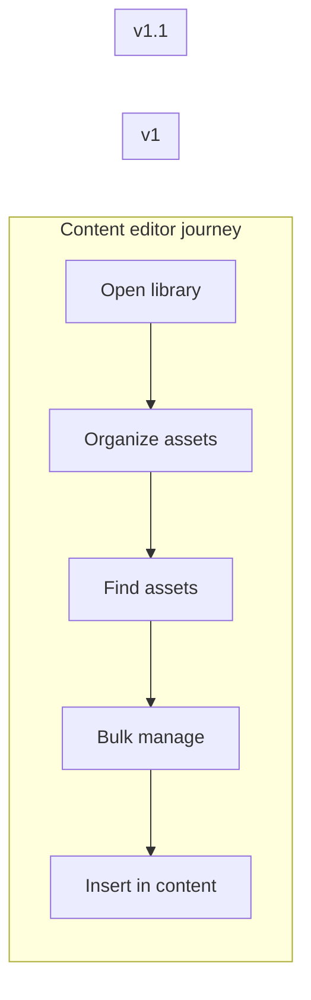

# Examples

## Generic: media library initiative (abbreviated)

**Initiative:** Advanced Media Library

**Outcome:** Enable power users to efficiently organize, search, and reuse large media collections.

### Capabilities → epics

| Capability | Epic summary | Slice |
|------------|--------------|-------|
| Media taxonomy & organization | Custom taxonomies, grid assignment | v1 |
| Enhanced media grid UX | Bulk selection, infinite scroll | v1 |
| Advanced search & filters | Multi-criteria search, saved presets | v1 |
| Dynamic galleries & playlists | Blocks, shortcodes | v1.1 |
| Performance & compatibility | Indexing, large libraries | v1.1 |

### Story map (excerpt)

### v1 story (excerpt)

**Title:** Filter media by multiple taxonomies and date range

**Epic:** Advanced search & filters

**Implementation spec highlights (repo-specific in real use):**

- REST: extend media query args; capability checks
- Admin grid: filter bar component; URL-persisted filter state
- Indexing: taxonomy + date composite index if needed
- E2E: editor applies filters and sees correct grid count

Future v1.1 stories (e.g. saved filter presets) appear only in the capability **feature list** until that slice is scheduled.

---

## Deep dives

Large single-capability specs belong in the product repo (e.g. `spec-*-epic-*.md`), linked from the initiative doc. This example stays product-neutral.

When a repo has an existing initiative-style spec, treat it as a partial example: extract the capability/slice pattern, do not copy product-specific paths into this skill.

---

## Handoff after roadmap

| Next step | Skill |
|-----------|-------|
| Expand v1 story into PRD + seams | `to-prd` |
| RED→GREEN delivery plan | the story Plan step |
| Tracer-bullet issues from a plan | `to-issues` |
| Stress-test one constraint | `grill-with-docs` |
