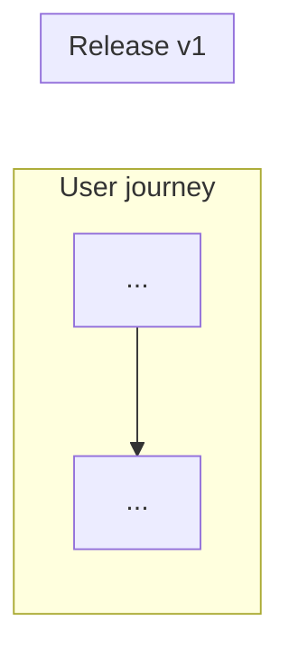

# Initiative: [Name]

> **Outcome:** [One sentence — what changes for users when this initiative is complete.]
>
> **Roadmap themes:** [e.g. performance, authoring UX, content management]
>
> **Status:** Draft | Approved | In delivery
>
> **Jira:** [Parent epic PROJ-xxx or —]

## Success metrics

- [Metric 1]
- [Metric 2]

## Current state

What exists in the codebase/product today. What gaps this initiative addresses.

## Story map

<!-- Required. Mermaid preferred; see SKILL.md -->

| Backbone step | Capability | v1 | v1.1 | v1.2 |
|---------------|------------|----|------|------|
| ... | ... | ✓ | | |

## Ambiguity register

| # | Question | Impact | Assumption (draft) | Blocks | Status |
|---|----------|--------|-------------------|--------|--------|
| 1 | ... | Capability X / feature Y | ... | v1 | open |

Resolved items: move to **Resolved assumptions** under the relevant story or capability. Deferred items: note target slice (v1.1+).

**Strict gate:** No v1 Jira stories until **every** `Blocks: v1` row is `resolved` or reclassified off v1 (see SKILL.md step 4b).

## Release plan

| Slice | Theme | MoSCoW scope | Risk tags |
|-------|-------|--------------|-----------|
| v1 | ... | Must: ... | perf, compat |
| v1.1 | ... | Should: ... | schema |
| v1.2 | ... | Could: ... | |

### v1 — out of scope

- ...

### Initiative-wide — out of scope

- ...

## Capabilities

<!-- Repeat per capability -->

### [Capability name]

**Jira epic:** PROJ-xxx (created after publish)

**Value:** [One line]

**Release slice:** v1 | v1.1 | ...

**Risk tags:** schema | perf | compat | migration | security

#### UX scope

Screens, flows, states.

#### Tech constraints

Stack-specific limits (APIs, schema, caching, compatibility).

#### Integrations

REST, hooks, editor surfaces, third-party plugins, etc.

#### Features

| Feature | MoSCoW (v1) | Notes |
|---------|-------------|-------|
| ... | Must | |

#### Out of scope (this capability)

- ...

#### Dependencies

- Blocks: ...
- Blocked by: ...

#### Open ambiguities (capability / epic overview)

Deferred or unresolved at epic level — not blocking v1 stories, or pending future slice:

- ...

---

## v1 — stories

<!-- Full stories for v1 only. Future slices stay at feature list above. -->

### [Story title]

**Jira:** PROJ-xxx

**Epic:** [Capability name] (PROJ-xxx)

**User story:** As a [actor], I want [goal], so that [benefit].

**Acceptance criteria**

- [ ] ...
- [ ] ...

**Implementation spec**

- Data / API: ...
- UI / UX: ...
- Tests / verification: ...

**Resolved assumptions** (from ambiguity register — decisions that locked this story spec)

- ...

**Dependencies:** PROJ-xxx or None

---

## Jira index

| Level | Summary | Key |
|-------|---------|-----|
| Initiative | ... | PROJ-xxx |
| Capability | ... | PROJ-xxx |
| Story (v1) | ... | PROJ-xxx |

## Architecture decision record (ADR) candidates

Unresolved decisions better captured as ADRs (link to `grill-with-docs`):

- [ ] ...

## Ambiguity register (summary)

Link to table above. **Strict gate:** all `Blocks: v1` items must be `resolved` (or deferred off v1) before **any** v1 story is published to Jira.

## Revision log

| Date | Change |
|------|--------|
| YYYY-MM-DD | Initial roadmap |
