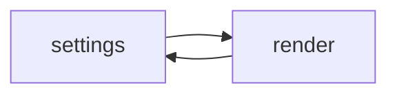
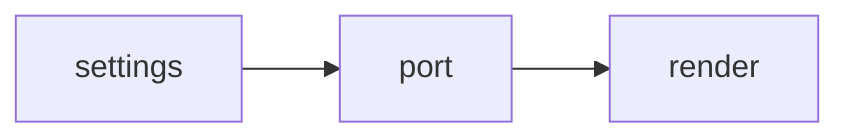

## phase

1. Roadmap agreed
2. **Architecture plan — current**
3. Split into stories

| Lock | Jira home | Status |
| --- | --- | --- |
| D0 module split | DEMO-245 | In Progress |

> Read this as: the split is agreed; next slice is the Design domain interface.

## finish-line

Start here now: DEMO-271 — To Do — epic DEMO-245 — blocks S2.

| # | Story | Epic | Jira | Depends on |
| --- | --- | --- | --- | --- |
| 1 | Define Design domain interface | DEMO-245 | DEMO-271 | — |
| 2 | Move render pipeline behind the seam | DEMO-245 | DEMO-272 | DEMO-271 |
| 🏁 | Platform stages complete | DEMO-245 | — | DEMO-272 |

## locks

**Locked**

- D0 — settings and render become separate modules

**Handoff**

1. Close DEMO-271, then plan S2

## current

Settings and render call each other directly, so neither ships alone.

## target

One interface owns the seam; render depends on the port only.

## decisions

### d0
- status: resolved · port interface
- title: D0 — module boundary

Chosen because it keeps WordPress hooks out of the render path.

## stages

Home epic: DEMO-245.

### stage-S1
- epic: DEMO-245
- story: DEMO-271
- status: To Do
- title: Define Design domain interface

Acceptance: render compiles against the port with no settings import.

## nongoals

- No block editor rewrite in this plan.
